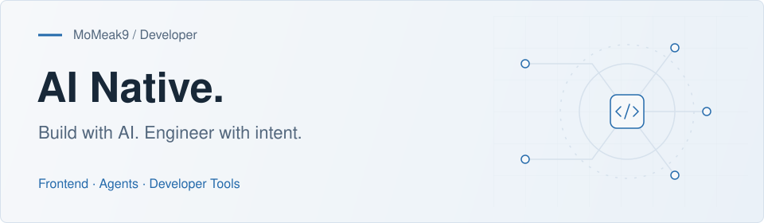

<picture>
  <source media="(prefers-color-scheme: dark)" srcset="./assets/profile-dark.svg">
  <source media="(prefers-color-scheme: light)" srcset="./assets/profile-light.svg">
  
</picture>

<h1 align="center">Hi there, I'm MoMeak9 👋</h1>

  

  <strong>AI Native Engineer</strong> 
  Frontend craft. Full-stack engineering. AI-powered experiences.

  <a href="https://yihuiblog.top/">Blog</a> &nbsp; / &nbsp;
  <a href="https://momeak9.github.io/MyDocs/">Notes</a> &nbsp; / &nbsp;
  <a href="https://juejin.cn/user/317122698296024">Juejin</a> &nbsp; / &nbsp;
  <a href="mailto:minntaki@foxmail.com">Contact</a>

---

## About Me

I'm an engineer with a strong **frontend foundation and a full-stack toolkit**, building thoughtful interfaces, developer tools, and AI applications.

My work connects **rich text editing, component infrastructure, backend services, and AI workflows**. I focus on bringing model capabilities into useful interactions, connecting agents to tools and context, and making complex workflows maintainable.

> Clear interactions. Traceable context. Results people can review and trust.

## Experience

**bilibili · Senior Software Engineer**

June 2023 — Present

Build core web experiences, with a focus on content creation, reusable UI infrastructure, and web security engineering.

- **Rich text editing:** Led an editor architecture upgrade with Tiptap / ProseMirror, using a headless, plugin-based design. Improved content pasting across sources, formatting normalization, and custom content nodes.
- **Component infrastructure:** Built and maintained a component library from the ground up. Supported application modernization with Vue 3, TypeScript, a monorepo, and Vite, including automated testing and SSR compatibility.
- **Web security:** Owned SDK architecture and integration capabilities, focusing on runtime isolation, compatibility, and graceful degradation for reliable business integration.

## AI Engineering

### 01 / AI-Powered Interfaces

Integrate LLM capabilities into product workflows, including AI text suggestions in collaborative editors. Use **diff previews, per-suggestion accept / reject controls, and loading and error states** to keep users in control of generated changes.

### 02 / Agent Tools & Context

Build reusable context capabilities for coding agents through **CLI tools, MCP servers, and plugin integrations**. Work with Markdown + Git memory storage, local retrieval, and session-aware recall to support auditable memory and context reuse across repositories.

### 03 / Multi-Agent Workflows

Develop applications on existing agent frameworks with **LangGraph orchestration, specialized agent roles, LLM provider abstractions, and data adapters**. Expose multi-stage workflows through CLI and API interfaces.

### 04 / Reliable AI Applications

Work on the engineering around model calls: **structured tool outputs, source attribution, explicit missing-data signals, asynchronous task states, regression tests, and deployment configuration**. Keep outputs inspectable and failures easier to diagnose.

## Tech Stack

| Area | Technologies & Tools |
| :--- | :--- |
| Frontend | TypeScript · JavaScript · HTML · CSS · React · Vue · Next.js |
| Styling | Tailwind CSS · Sass · Styled Components |
| Backend | Go · Node.js · Python |
| Data & Caching | MySQL · Redis · SQLite / FTS |
| Infrastructure | Kubernetes (K8s) · Docker · Git |
| AI & Agents | LLM APIs · LangGraph · MCP · Agent Memory |
| Collaborative Editing | Tiptap · ProseMirror · Yjs · WebSocket · Diff Review |
| Systems & Runtime | Rust · WebAssembly |
| Tooling & Quality | Monorepo · Vite · Rollup · ESLint · Automated Testing · SSR Testing |

## Writing & Contact

I share engineering ideas and lessons on my [blog](https://yihuiblog.top/), in my [technical notes](https://momeak9.github.io/MyDocs/), and on [Juejin](https://juejin.cn/user/317122698296024).

**Email:** [minntaki@foxmail.com](mailto:minntaki@foxmail.com)

---

  Build with AI. Engineer with intent. 
  Stay curious. Turn ideas into working software.

